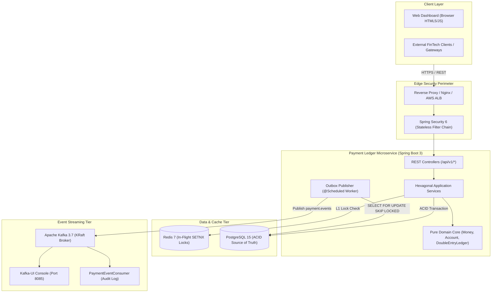
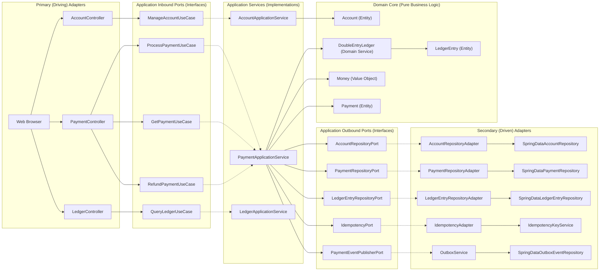
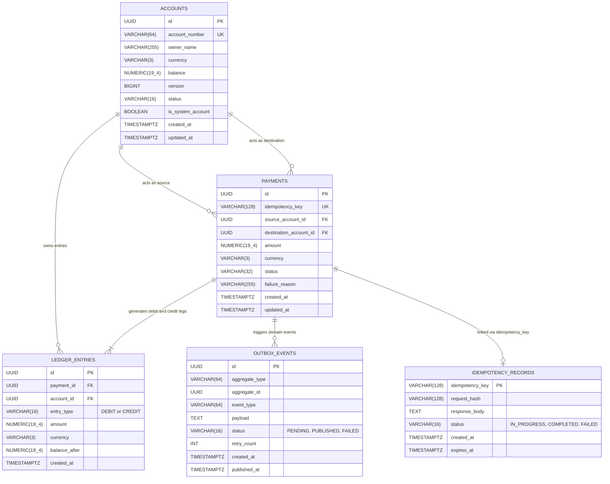
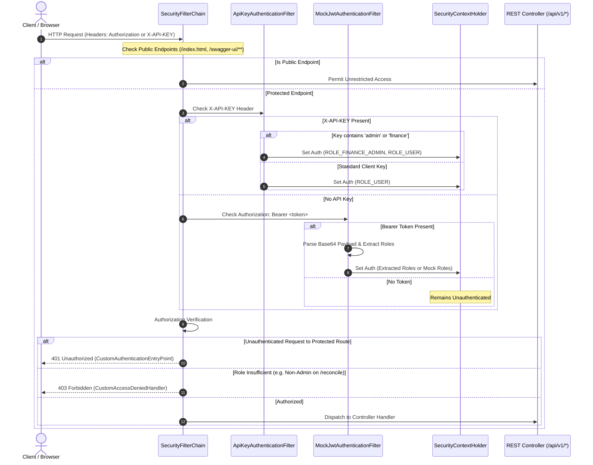
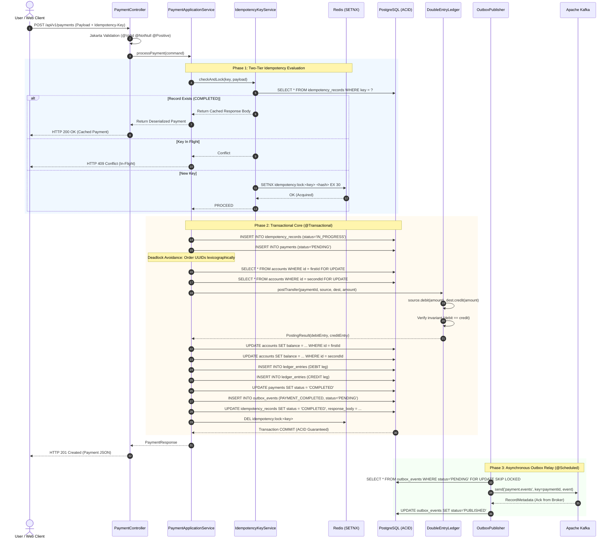
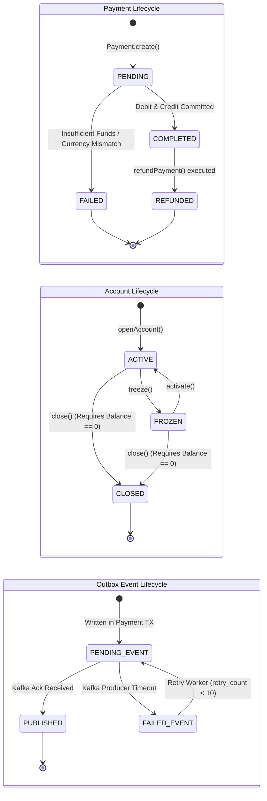
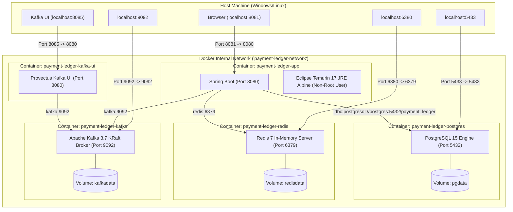

# 03. System Architecture Deep Dive & Mermaid Blueprints

> **Scope:** Comprehensive architectural analysis from beginner to FAANG-staff level, covering request lifecycles, concurrency boundaries, data pipelines, and deployment topologies with 7 Mermaid diagrams.

---

## 1. High-Level System Architecture

The Payment Ledger is structured as an event-driven, hexagonal microservice backed by high-durability relational storage, distributed in-memory locking, and an asynchronous distributed commit log.

### Diagram 1: High-Level System Architecture

### Step-by-Step Explanation:
1. **Client Interaction:** Users interact via the Single-Page Web Dashboard (`localhost:8081`) or via programmatic REST API calls supplying an `Idempotency-Key` header.
2. **Security Interception:** Requests enter Spring Security's filter chain (`SecurityConfig`). Static web assets and OpenAPI docs bypass auth; customer endpoints require Bearer tokens or `X-API-KEY`.
3. **Hexagonal Orchestration:** Controllers invoke Inbound Ports (`ProcessPaymentUseCase`). Application services orchestrate domain business logic, coordinating Redis locks and PostgreSQL database transactions.
4. **Data Durability:** Accounts and ledger entries are committed atomically in PostgreSQL inside a single ACID boundary.
5. **Decoupled Event Streaming:** Domain events written to `outbox_events` are polled asynchronously by the `OutboxPublisher` and dispatched to Kafka, ensuring zero dual-write vulnerabilities.

---

## 2. Backend Component Architecture (Hexagonal Ports & Adapters)

This service strictly adheres to **Hexagonal Architecture** (also known as Ports and Adapters) and **Domain-Driven Design (DDD)**.

### Diagram 2: Hexagonal Ports & Adapters Architecture

### Architectural Rules Enforced:
1. **Dependency Inversion Principle:** The Domain Core has **zero dependencies** on Spring, Hibernate, Redis, or Kafka.
2. **Testability:** Domain models (`DoubleEntryLedgerTest`, `MoneyTest`) are unit tested without starting Spring, executing in milliseconds.
3. **Pluggable Persistence:** If PostgreSQL is replaced with another datastore, only the Driven Adapters (`*RepositoryAdapter`) change; the business logic remains untouched.

---

## 3. Database Entity Relationship Diagram (ERD)

The relational schema is normalized to prevent anomalies while providing an immutable financial audit trail.

### Diagram 3: Database Entity Relationship Diagram

---

## 4. Authentication & Authorization Flow

The application implements a stateless dual-credential security filter chain supporting API Keys and Bearer JWTs.

### Diagram 4: Security Filter Chain & RBAC Flow

---

## 5. Complete End-to-End Request Lifecycle (Money Transfer)

This diagram tracks the lifecycle of `POST /api/v1/payments` from the browser DOM event to database commit and Kafka event receipt.

### Diagram 5: Complete Money Transfer Request Lifecycle

---

## 6. Payment & Account State Transition Lifecycle

### Diagram 6: State Transition State Machines

---

## 7. Containerized Deployment Topology

### Diagram 7: Docker Compose Deployment Topology

