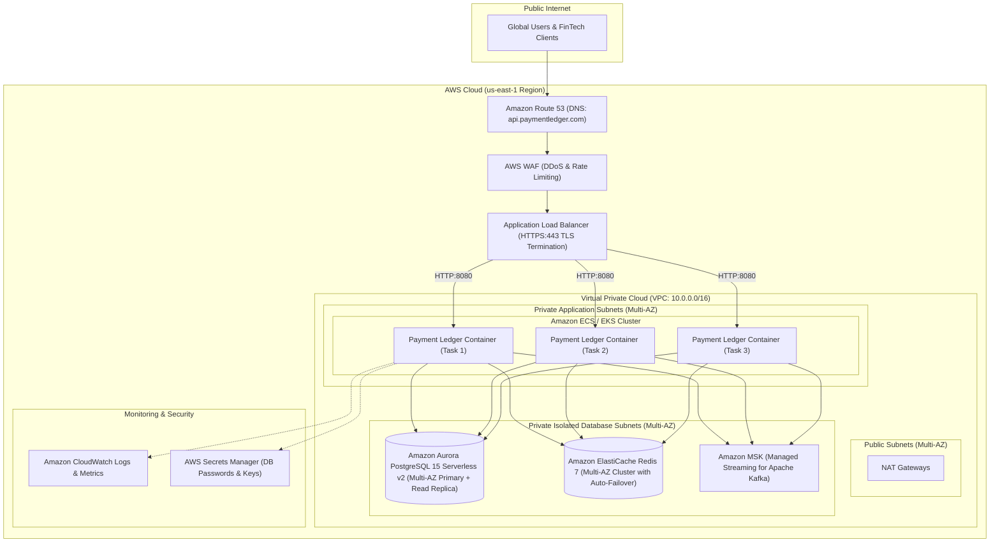

# 10. Docker, AWS Infrastructure & CI/CD Deployment Blueprint

> **Scope:** Containerization mechanics, Docker Compose networking, CI/CD pipeline automation, production AWS cloud blueprint (ECS Fargate, RDS Aurora, ElastiCache, MSK), and step-by-step production runbooks.

---

## 1. Local Container Architecture (Docker Compose)

The repository provides a production-grade multi-container topology orchestrated via `docker-compose.yml`.

### Services & Network Topology:

```
HOST MACHINE (Windows/macOS/Linux)
 │
 ├── Port 8081 ──────► [ payment-ledger-app ] (Spring Boot 3.2.5, JRE 17 Alpine)
 ├── Port 5433 ──────► [ payment-ledger-postgres ] (PostgreSQL 15 Alpine, Port 5432)
 ├── Port 6380 ──────► [ payment-ledger-redis ] (Redis 7 Alpine, Port 6379)
 ├── Port 9092 ──────► [ payment-ledger-kafka ] (Apache Kafka 3.7 KRaft Mode)
 └── Port 8085 ──────► [ payment-ledger-kafka-ui ] (Web Management Console)
```

### Key Compose Configuration Details:
1. **Health Checks:**
   - PostgreSQL uses: `pg_isready -U payment_user -d payment_ledger` (interval: 5s, retries: 5).
   - Redis uses: `redis-cli ping` (interval: 5s, retries: 5).
   - The Spring application container specifies `depends_on` with `condition: service_healthy`, preventing boot failures caused by database connection refusal.
2. **Persistent Volumes:**
   - `pgdata`: Preserves database tables across container restarts.
   - `redisdata`: Preserves Redis keyspace.
   - `kafkadata`: Preserves Kafka partition topic segments.
3. **Kafka KRaft Mode (Zero Zookeeper):**
   - Configured with `KAFKA_PROCESS_ROLES: broker,controller` and `KAFKA_NODE_ID: 1`. Eliminates the operational complexity and memory overhead of maintaining an external Apache Zookeeper ensemble.

---

## 2. CI/CD Pipeline Automation (GitHub Actions)

The repository contains two automated workflows under `.github/workflows/`:

### 1. `ci.yml` (Continuous Integration)
- **Triggers:** Push or Pull Request on `main`.
- **Steps:**
  1. `actions/checkout@v4` (fetches source code).
  2. `actions/setup-java@v4` with Temurin JDK 17 and Maven caching.
  3. `mvn clean compile` (validates syntax and bytecode).
  4. `mvn test` (executes unit and Testcontainers integration tests).
  5. `mvn package -DskipTests` (builds production executable JAR).
  6. `docker build -t payment-ledger:${{ github.sha }} .` (validates container build).

### 2. `concurrency-and-load-tests.yml`
- Runs PostgreSQL and Redis service containers in the GitHub runner.
- Executes `ConcurrentPaymentTest`, `DoubleEntryLedgerTest`, `IdempotencyTest`, and `LedgerInvariantTest`.
- Starts the Spring Boot JAR in the background and runs Grafana k6 (`load-tests/k6-payment-transfer.js`) to assert strict latency and error-rate SLAs in CI before merging.

---

## 3. Production AWS Deployment Blueprint

In an interview, you should explain how this local container setup maps to enterprise AWS cloud infrastructure.



---

## 4. Production Deployment & Troubleshooting Runbook

### How to Deploy from Scratch (Local / Staging):
```bash
# 1. Clone repository
git clone https://github.com/itspawanyadavv-jpg/PAYMENT-LEDGER.git
cd PAYMENT-LEDGER

# 2. Verify environment configuration
cp .env.example .env

# 3. Boot infrastructure stack
docker compose up -d postgres redis kafka kafka-ui

# 4. Wait for healthy state (takes ~15 seconds)
docker compose ps

# 5. Run the Spring Boot microservice
./mvnw spring-boot:run
```

### Top 3 Production Failure Scenarios & Debugging Steps:

#### Scenario A: Database Connection Exhaustion
- **Symptom:** API returns `500 Internal Server Error`, logs show `HikariPool-1 - Connection is not available, request timed out after 3000ms`.
- **Root Cause:** Long-running transactions or lock waits holding connections while new requests continue to arrive.
- **Resolution:**
  1. Inspect active PostgreSQL locks:
     ```sql
     SELECT pid, usename, pg_blocking_pids(pid) AS blocked_by, query 
     FROM pg_stat_activity 
     WHERE cardinality(pg_blocking_pids(pid)) > 0;
     ```
  2. Terminate the blocking PID: `SELECT pg_terminate_backend(<blocking_pid>);`
  3. Increase Hikari pool size or scale microservice pods horizontally.

#### Scenario B: Outbox Relay Stalled (Kafka Offline)
- **Symptom:** Payments succeed, but Kafka UI shows no new messages in `payment.events`; `outbox_events` table accumulates thousands of `FAILED` rows.
- **Root Cause:** Kafka broker crashed, network partition, or topic ACL misconfiguration.
- **Resolution:**
  1. Check Kafka container health: `docker logs payment-ledger-kafka`.
  2. The application guarantees **zero data loss**: events remain safely persisted in `outbox_events`.
  3. Once Kafka recovers, trigger re-publishing by resetting failed events:
     ```sql
     UPDATE outbox_events SET status = 'PENDING' WHERE status = 'FAILED' AND retry_count < 10;
     ```

#### Scenario C: Port Collision on Host Startup
- **Symptom:** `docker compose up` fails with `Bind for 0.0.0.0:5433 failed: port is already allocated`.
- **Resolution:**
  1. Identify the occupying process:
     ```powershell
     Get-NetTCPConnection -LocalPort 5433 | Select-Object OwningProcess
     ```
  2. Modify `POSTGRES_PORT` in `.env` (e.g. change to `5434`) and restart.
